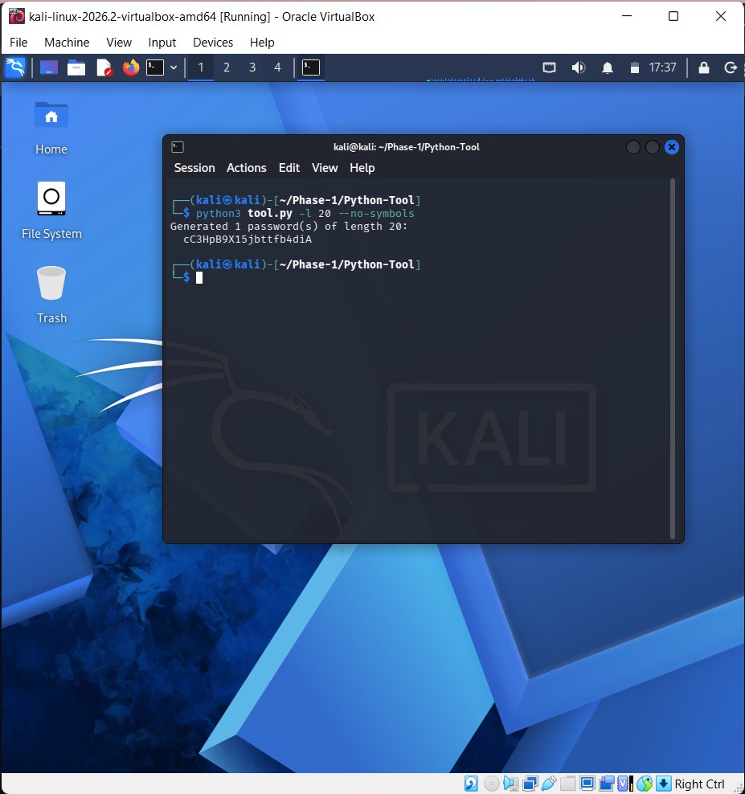
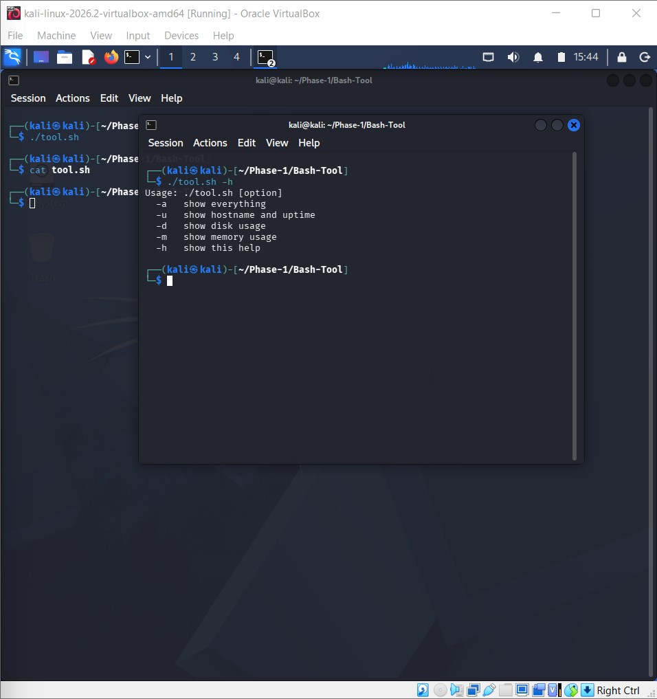
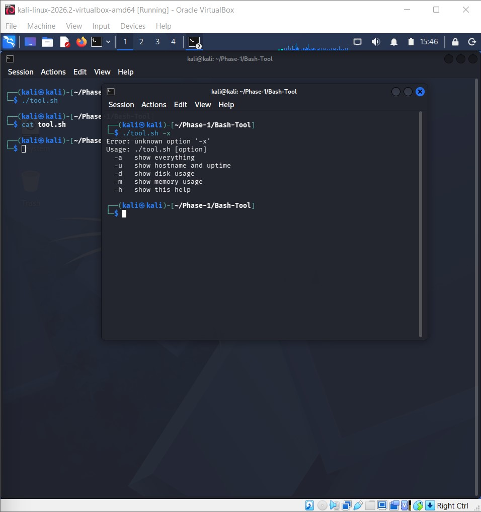

# Password Generator

## Objective
A Python tool that creates random, strong passwords. The user can choose the length, how many passwords to make, and whether to include symbols. It helps people avoid weak or reused passwords.

## Features
- Generates secure random passwords using Python's `secrets` module
- Choose the password length (8 to 128 characters)
- Generate several passwords at once (1 to 50)
- Option to use only letters and numbers
# Password Generator

## Objective
A Python tool that creates random, strong passwords. The user can choose the length, how many passwords to make, and whether to include symbols. It helps people avoid weak or reused passwords.

## Features
- Generates secure random passwords using Python's `secrets` module
- Choose the password length (8 to 128 characters)
- Generate several passwords at once (1 to 50)
- Option to use only letters and numbers
- Error messages for invalid input
- Built-in help option (-h)

## Requirements
- Python 3
- No extra libraries needed (uses only built-in modules: argparse, secrets, string, sys)

## How to Run
```bash
python3 tool.py
```

## Example Usage
```bash
python3 tool.py                       # one password, 12 characters
python3 tool.py -l 20                 # one password, 20 characters
python3 tool.py -c 3                  # three passwords
python3 tool.py -l 16 --no-symbols    # letters and numbers only
python3 tool.py -h                    # help
```

## Example Output





## Challenges Faced
- I had to learn how `argparse` reads options like `-l` and `-c`.
- Pasting did not work with Ctrl + V in the terminal, so I used Ctrl + Shift + V.
- I tested many commands one by one to be sure the error messages showed correctly.
- I got the screenshot file names wrong at first, so I had to rename them.

## Future Improvements
- Add a password strength checker.
- Save the generated passwords to a file.
- Make sure every password has at least one uppercase letter, number and symbol.
- Copy the password to the clipboard automatically.
